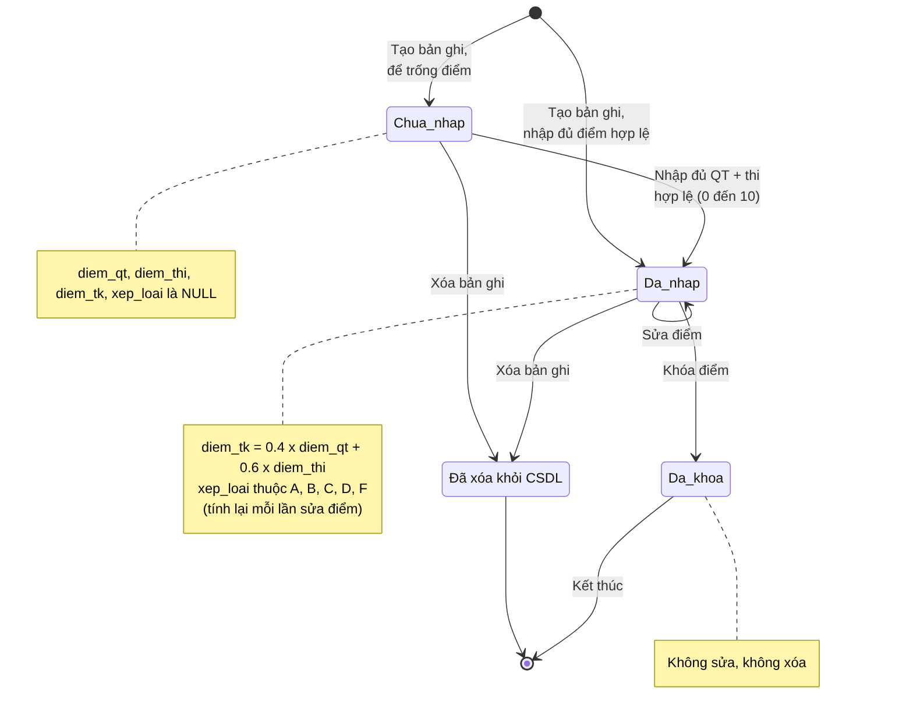
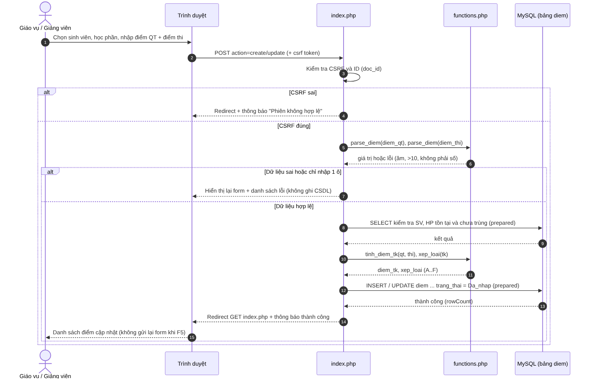
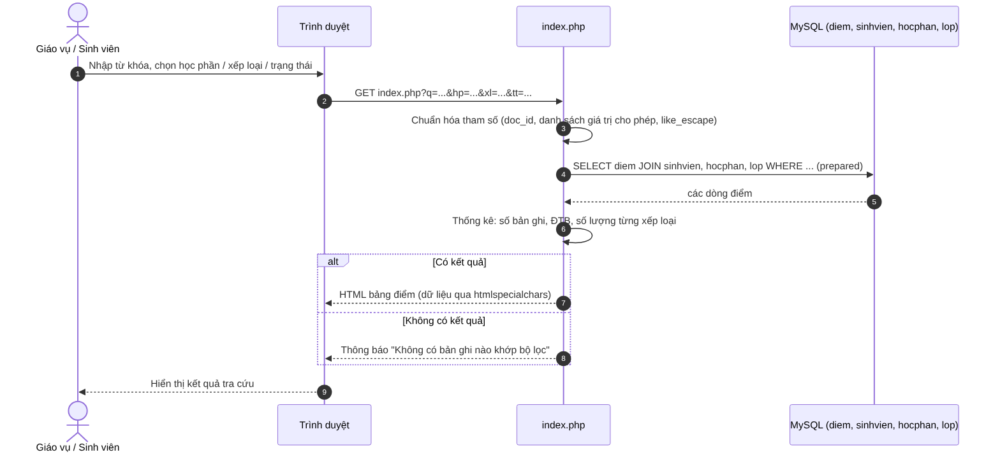
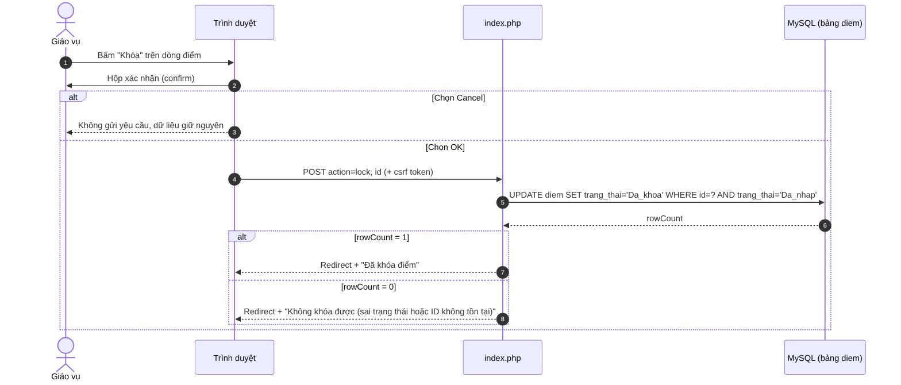

# Phần thiết kế nhóm – Thành viên 5

**Đề tài:** Quản lý sinh viên và điểm học phần (Nhóm 09)
**Phụ trách:** Sơ đồ Tuần tự (Sequence), Sơ đồ Trạng thái (State) cho bảng `diem` – luồng xếp loại & tra cứu điểm.
**Người phối hợp:** Thành viên 4 (công thức tính điểm, quy tắc xếp loại), Thành viên 3 (cột `trang_thai` trong `database.sql`).

---

## 1. Quy tắc nghiệp vụ dùng chung (cần thống nhất với Thành viên 4)

| Nội dung | Quy tắc |
|---|---|
| Điểm thành phần | `diem_qt` (quá trình) và `diem_thi` (thi), mỗi điểm trong khoảng 0–10, tối đa 2 chữ số thập phân |
| Điểm tổng kết | `diem_tk = 0.4 × diem_qt + 0.6 × diem_thi`, làm tròn 2 chữ số |
| Xếp loại | **A** ≥ 8.5 · **B** ≥ 7.0 · **C** ≥ 5.5 · **D** ≥ 4.0 · **F** < 4.0 |
| Nhập sai | Điểm âm, lớn hơn 10, không phải số, hoặc chỉ nhập một trong hai điểm → báo lỗi, không ghi CSDL |
| Ràng buộc | Mỗi sinh viên chỉ có 1 bản ghi điểm cho 1 học phần (`UNIQUE (sinhvien_id, hocphan_id)`) |

> Công thức 40/60 và các mốc xếp loại là cách chia phổ biến mà mình chọn làm mặc định. Nếu nhóm/giảng viên dùng tỉ lệ hoặc mốc khác, chỉ cần sửa 2 hằng số `TRONG_SO_QT`, `TRONG_SO_THI` và hàm `xep_loai()` trong `src/functions.php` (cùng chú thích ở `database.sql`).

---

## 2. Sơ đồ Trạng thái (State Diagram) – vòng đời điểm học phần



Mã nguồn sơ đồ: `hinh/trang_thai_diem.mmd` (Mermaid).

### Bảng đối chiếu sơ đồ ↔ cột `diem.trang_thai` (đối chiếu với Thành viên 3)

| Trạng thái trong sơ đồ | Giá trị cột `trang_thai` | Trạng thái dữ liệu | Hành động cho phép trong chương trình |
|---|---|---|---|
| Chưa nhập | `Chua_nhap` | `diem_qt`, `diem_thi`, `diem_tk`, `xep_loai` đều NULL | Nhập điểm, Xóa |
| Đã nhập | `Da_nhap` | Đủ `diem_qt`, `diem_thi`; `diem_tk`, `xep_loai` đã tính | Sửa điểm, Khóa, Xóa |
| Đã khóa | `Da_khoa` | Giữ nguyên như Đã nhập | Chỉ xem / tra cứu (chương trình chặn Sửa, Xóa, ngay trong câu SQL `WHERE`) |

Các chuyển trạng thái và điều kiện:

| Từ | Sang | Sự kiện / điều kiện (guard) |
|---|---|---|
| (bắt đầu) | Chưa nhập | Thêm bản ghi, để trống cả hai ô điểm |
| (bắt đầu) | Đã nhập | Thêm bản ghi, nhập đủ hai điểm hợp lệ |
| Chưa nhập | Đã nhập | Nhập đủ hai điểm hợp lệ (0–10) |
| Đã nhập | Đã nhập | Sửa điểm hợp lệ → tính lại `diem_tk`, `xep_loai` |
| Đã nhập | Đã khóa | Bấm Khóa + xác nhận; SQL: `... WHERE id = ? AND trang_thai = 'Da_nhap'` |
| Chưa nhập / Đã nhập | (xóa) | Xóa bản ghi; SQL: `... WHERE id = ? AND trang_thai <> 'Da_khoa'` |

Ràng buộc trong `database.sql`: `CHECK (trang_thai IN ('Chua_nhap','Da_nhap','Da_khoa'))`, `DEFAULT 'Chua_nhap'`.

Câu lệnh kiểm tra chéo sơ đồ ↔ CSDL (chạy trong phpMyAdmin):

```sql
-- Mọi bản ghi Chua_nhap phải chưa có điểm (kết quả mong đợi: 0 dòng)
SELECT id FROM diem WHERE trang_thai = 'Chua_nhap'
  AND (diem_qt IS NOT NULL OR diem_thi IS NOT NULL OR diem_tk IS NOT NULL OR xep_loai IS NOT NULL);

-- Mọi bản ghi Da_nhap / Da_khoa phải đủ điểm và đã xếp loại (kết quả mong đợi: 0 dòng)
SELECT id FROM diem WHERE trang_thai IN ('Da_nhap','Da_khoa')
  AND (diem_qt IS NULL OR diem_thi IS NULL OR diem_tk IS NULL OR xep_loai IS NULL);

-- diem_tk phải khớp công thức (kết quả mong đợi: 0 dòng)
SELECT id FROM diem WHERE diem_tk IS NOT NULL AND ABS(diem_tk - ROUND(0.4*diem_qt + 0.6*diem_thi, 2)) > 0.001;
```

---

## 3. Sơ đồ Tuần tự (Sequence Diagram)

Các đối tượng tham gia: Giáo vụ/Giảng viên (người dùng) → Trình duyệt → `index.php` → `functions.php` → MySQL (các bảng `diem`, `sinhvien`, `hocphan`, `lop`).

### 3.1. Luồng nhập điểm & xếp loại



Điểm chính: kiểm tra CSRF → kiểm tra dữ liệu (nhánh lỗi: điểm < 0, > 10, không phải số, thiếu một ô) → kiểm tra sinh viên/học phần tồn tại và chưa trùng → tính tổng kết + xếp loại → INSERT/UPDATE bằng prepared statement → chuyển hướng (tránh gửi lại form khi F5).

### 3.2. Luồng tra cứu / xem điểm



### 3.3. Luồng khóa điểm



Mã nguồn các sơ đồ: `hinh/*.mmd`. Muốn vẽ lại: `mmdc -i hinh/ten_file.mmd -o hinh/ten_file.png -s 2 -b white`, hoặc dán nội dung `.mmd` vào https://mermaid.live.

---

## 4. Việc kiểm tra chéo (theo lịch của nhóm)

- Thành viên 4 kiểm tra phần này: đối chiếu Sơ đồ Tuần tự và Sơ đồ Trạng thái với tên bảng/cột trong `database.sql` (bảng `diem`, cột `trang_thai`, `diem_tk`, `xep_loai`; bảng `sinhvien`, `hocphan`).
- Thành viên 5 kiểm tra phần của Thành viên 1: Sơ đồ Use Case, Sơ đồ Triển khai và tính đầy đủ hồ sơ nộp.
- Điểm cần chốt với Thành viên 4: công thức tính điểm tổng kết và các mốc A/B/C/D/F (mục 1).
- Điểm cần chốt với Thành viên 3: cột `trang_thai` dùng đúng 3 giá trị `Chua_nhap`, `Da_nhap`, `Da_khoa`; `diem_qt`, `diem_thi`, `diem_tk`, `xep_loai` cho phép NULL (để biểu diễn trạng thái Chưa nhập).

*(Ghi kết quả kiểm tra chéo thực tế vào `DONG_GOP.md` của nhóm sau khi hai bên đã đối chiếu.)*
